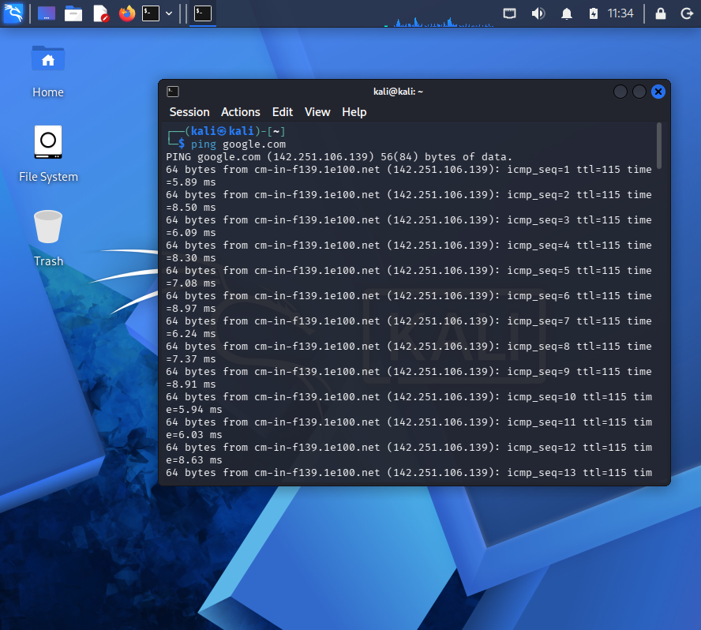

# Kali Linux Network Configuration and Connectivity Testing

## 1. Introduction

This project demonstrates Kali Linux setup in Oracle VirtualBox, NAT Network configuration, and internet connectivity testing using the ping command.

## 2. Kali Linux Login

Start the Kali Linux virtual machine and log in using your username and password.


## 3. VirtualBox Network Configuration

Configure Adapter 1 with the following settings:

| Setting | Value |
|---|---|
| Enable Network Adapter | Enabled |
| Attached To | NAT Network |
| Name | NatNetwork |
| Adapter Type | Intel PRO/1000 MT Desktop (82540EM) |
| Promiscuous Mode | Allow All |
| Cable Connected | Enabled |


## 4. Internet Connectivity Testing

Open the Kali Linux terminal and execute the following command:

```bash
ping google.com
```

### Output

```text
PING google.com (142.251.106.139) 56(84) bytes of data.
64 bytes from ...: icmp_seq=1 ttl=115 time=5.89 ms
64 bytes from ...: icmp_seq=2 ttl=115 time=8.50 ms
64 bytes from ...: icmp_seq=3 ttl=115 time=6.09 ms
64 bytes from ...: icmp_seq=4 ttl=115 time=8.30 ms
```



## 5. Result

Successfully configured Kali Linux networking using NAT Network in Oracle VirtualBox.

Internet connectivity was verified through successful ICMP echo replies using the `ping google.com` command.

## 6. Conclusion

Kali Linux was successfully configured in Oracle VirtualBox, and internet connectivity was tested using the ping command.

**Tools Used:** Kali Linux | Oracle VirtualBox | Terminal | Ping
