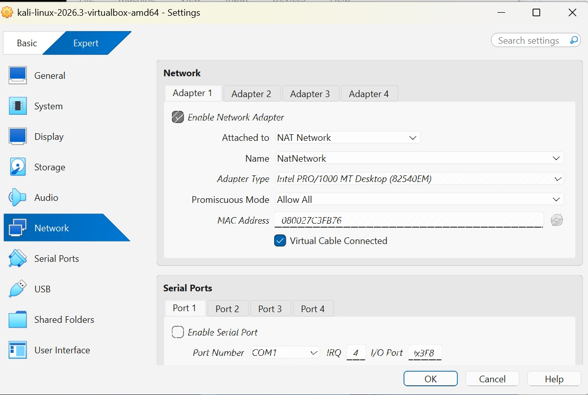

# Cybersecurity Lab Environment Setup


---

## Project Overview

This project is part of my Cybersecurity Internship. The objective was to set up a Kali Linux virtual machine using Oracle VirtualBox and configure its network connection for cybersecurity lab practice.

I deployed the virtual machine, configured the network adapter using NAT Network, and tested internet connectivity using the `ping` command.

All activities were performed in my own lab environment.

## Objectives

- Deploy a Kali Linux virtual machine in VirtualBox.
- Configure the network adapter using NAT Network.
- Verify internet connectivity using the ping command.
- Prepare the lab environment for future cybersecurity practicals.

## Lab Environment

| Component | Details |
|---|---|
| Host Operating System | Windows |
| Hypervisor | Oracle VirtualBox |
| Guest Operating System | Kali Linux |
| Network Configuration | NAT Network |
| Network Adapter | Intel PRO/1000 MT Desktop |
| Connectivity Testing | Ping Command |

---

## Setup and Verification

### Step 1: Deploy Kali Linux

Downloaded and imported the Kali Linux virtual machine into Oracle VirtualBox and started it successfully.


### Step 2: Configure the Network Adapter

Configured Adapter 1 in VirtualBox with the following settings:

| Setting | Configuration |
|---|---|
| Enable Network Adapter | Enabled |
| Attached To | NAT Network |
| Name | NatNetwork |
| Adapter Type | Intel PRO/1000 MT Desktop (82540EM) |
| Promiscuous Mode | Allow All |
| Cable Connected | Enabled |



### Step 3: Test Network Connectivity

After configuring the network adapter, I used the `ping` command to test connectivity to Google.

**Command used:**

```bash
ping google.com
```

**Observed Output:**

The terminal returned ICMP echo replies from Google's IP address, confirming that the Kali Linux virtual machine could reach the internet.


---

## Result

- Successfully deployed Kali Linux in Oracle VirtualBox.
- Configured the network adapter using NAT Network.
- Verified internet connectivity through the ping command.

## Troubleshooting

No major configuration issues prevented the virtual machine from accessing the internet.

The ping output showed some duplicate responses and packet loss, which are worth investigating in further network testing.

## What I Learned

- How to deploy and run a Kali Linux virtual machine.
- How virtualization works using Oracle VirtualBox.
- How to configure a NAT Network adapter.
- How to use the ping command for connectivity testing.
- The importance of verifying network connectivity before performing cybersecurity practicals.

## Legal and Ethical Notice

This lab was configured for educational purposes in my own virtual environment.

Any future security testing will be limited to systems I own or have explicit permission to test.

---

## Author

**Janhavi Choudhary**

Cybersecurity Enthusiast | Engineering Student

